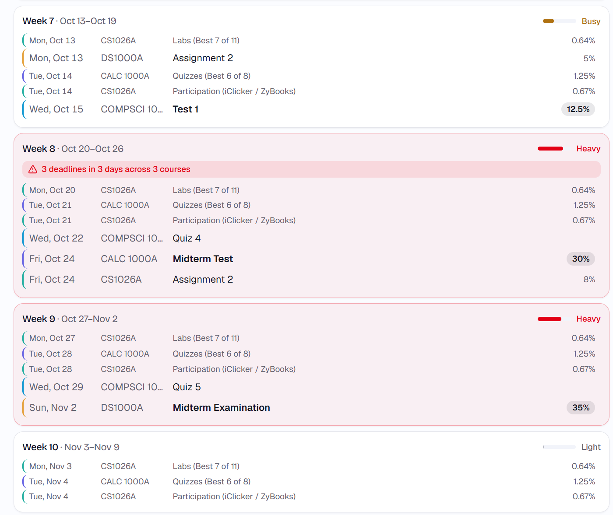
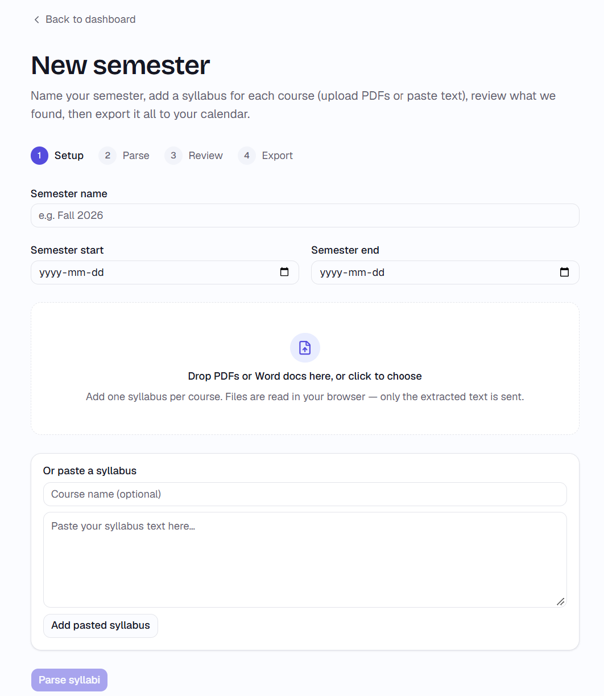
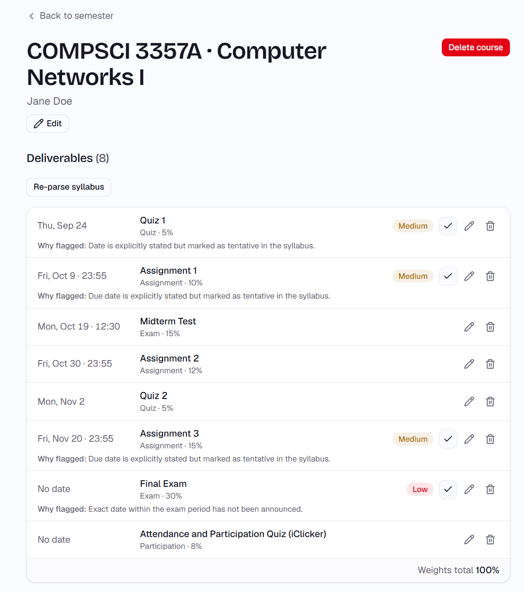
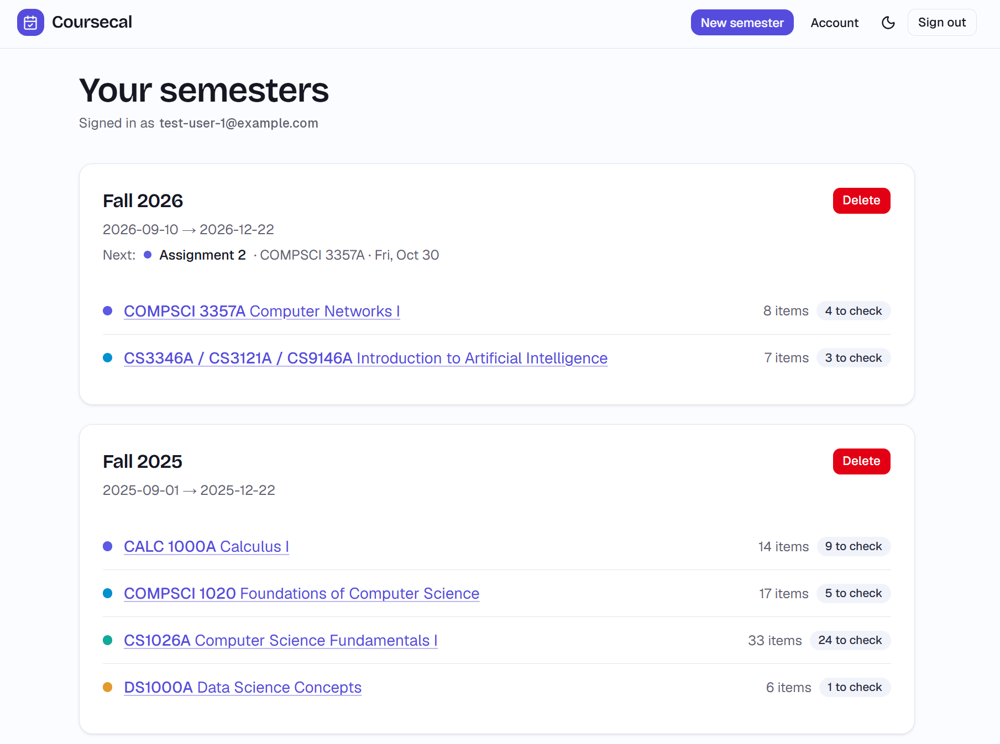

# Coursecal

[](https://github.com/BandonC/CourseCal/actions/workflows/evals.yml)



Turns course syllabi into calendar events and a navigable semester plan. Upload or paste your syllabi at the start of a term; Coursecal extracts every graded deliverable — assignments, quizzes, exams, projects, presentations, participation — and exports them to Google Calendar with reminders. A per-semester timeline flags hell weeks and clustered deadlines so you can see the whole term at a glance and plan around the crunch.

**Live:** [coursecal.bandonc.com](https://coursecal.bandonc.com) · OAuth is in Testing mode (invite-only) for now.

> A portfolio project, built for real use. Replaces the hour of manual deadline-copying every student does each semester with a few minutes of review.

## Parser accuracy

Prompt v2 (`claude-sonnet-4-6`) on ten real, hand-labeled syllabi (69 deliverables), against a regex baseline:

| System | Recall | Precision | Type | Explicit-date | Weight | Recurrence |
| --- | --- | --- | --- | --- | --- | --- |
| **syllabus-parser v2** | **98.6%** | **97.1%** | 100% | **100%** | 100% | 87.5%¹ |
| syllabus-parser v1 | 98.6% | 90.7% | 98.5% | 100% | 100% | 87.5% |
| regex baseline | 43.5% | 39.0% | — | 15.0% | 4.5% | 0.0% |

Every stated calendar deadline lands on the exact day. v2's prompt change stopped the model from extracting ungraded items, which was most of v1's precision gap.

¹ The committed run. Across three recordings, v2 scored 75% on recurrence in two, losing one recurring series that v1 handled. The precision gain comes with that trade. Numbers are pinned by a committed response cache and re-checked in CI at no cost. Methodology and failure analysis are in [`EVALS.md`](packages/syllabus-parser/docs/EVALS.md).

## How it works

1. Sign in with Google (consent includes Calendar access).
2. Name your semester and set its start/end dates — these anchor relative dates like "Week 6."
3. Upload PDFs/DOCX or paste text, one course at a time or several at once. Text is extracted **in the browser** — files never leave your machine.
4. The server calls Claude to parse each syllabus into typed, structured deliverables, each with a confidence flag.
5. Review and edit inline; ambiguous items are flagged for a quick check.
6. Export to Google Calendar (course-prefixed titles, reminders). `.ics` download is the fallback for non-Google calendars.
7. Land on the semester timeline with conflicts flagged; the dashboard aggregates every semester.

Edits made later sync back to the calendar by stored event ID. Nothing is persisted until you export.

| Set up a semester | Review flagged items | See what's next |
| --- | --- | --- |
|  |  |  |

## Repository layout

A pnpm workspace: a standalone library plus the Next.js app that consumes it.

```
packages/syllabus-parser/   the parser — pure library, no build step (see its README)
apps/coursecal/             the Next.js app — auth, DB, Calendar sync, timeline, UI
docs/adr/                   architectural decision records
COURSECAL.md                project source of truth (scope, architecture, data model)
DECISIONS.md                running log of implementation choices
```

**`syllabus-parser`** is a pure function: `parseSyllabus(text, context) → Result<ParseResult, ParseError>`. It owns the output schema, the versioned prompts, and the relative-date resolver; it touches no filesystem, no network (except through an injected LLM client), and no app concerns. It reports honest, eval-backed accuracy numbers — see [`packages/syllabus-parser/README.md`](packages/syllabus-parser/README.md).

**`coursecal`** does everything else: browser-side text extraction, Google OAuth, persistence, Calendar sync, conflict detection, and the UI.

## Stack

Next.js 16 (App Router, RSC, server actions) · TypeScript strict · Tailwind + shadcn/ui · React Hook Form + Zod · Auth.js (Google) · Neon Postgres + Drizzle · Anthropic Claude (structured tool use) · `unpdf` / `mammoth` for client-side extraction · `googleapis` + `ics` for calendar export · Vitest + fast-check · Sentry + PostHog. Hosted on Vercel; DB on Neon.

## Development

```bash
pnpm install
pnpm dev          # run the app (apps/coursecal)
pnpm test         # run all tests
pnpm typecheck    # typecheck every package
pnpm lint
```

Environment variables are documented in `apps/coursecal/.env.example` (app) and `packages/syllabus-parser/.env.example` (library standalone). The app validates its env at startup with Zod and fails fast on missing config. Database migrations are generated with Drizzle and applied manually against the dev branch first — never from a deploy script.

## Engineering notes

- **Eval harness** — the parser is scored on ten real, hand-labeled syllabi, stratified by format, discipline, and recurrence, with a regex baseline for lift. A `$0` replay-mode gate runs in CI over a committed response cache. See [`docs/EVALS.md`](packages/syllabus-parser/docs/EVALS.md).
- **Prompts as first-class artifacts** — versioned TypeScript exports with an iteration history in [`PROMPT_DESIGN.md`](packages/syllabus-parser/docs/PROMPT_DESIGN.md).
- **Property-based date resolution** — relative dates ("Week 6," "Monday after reading week") resolve in a pure function covered by `fast-check`. See [`DATES.md`](packages/syllabus-parser/docs/DATES.md).
- **Conflict detection** — weekly workload density plus sliding-window clustering, with a cross-course penalty. See [`apps/coursecal/lib/conflict-detection/`](apps/coursecal/lib/conflict-detection).
- **ADRs** — non-trivial decisions are recorded in [`docs/adr/`](docs/adr).

## Security

All LLM calls are server-side; the Anthropic key never reaches the client. Every user-data query is scoped by session `userId`. Refresh tokens are encrypted at rest (AES-256-GCM). PDFs and DOCX are extracted in the browser — the server receives text only, rate-limited and length-capped before any LLM call. See `COURSECAL.md` §9.

## License

MIT © 2026 Brandon Chong
